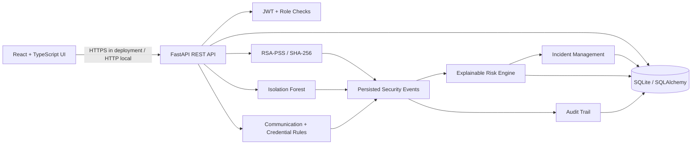

# Architecture

## Component responsibilities

- **React UI:** presentation, navigation, forms, tables, simulated scenario controls, and API errors. It does not calculate authoritative dashboard metrics.
- **FastAPI boundary:** request validation, authentication dependencies, role checks, HTTP status codes, and OpenAPI documentation.
- **SQLAlchemy / SQLite:** users, device inventory, one-time challenges, events, incidents, firmware metadata, settings, and audit rows.
- **Cryptographic service:** password hashing, HMAC-signed expiring JWTs, RSA-PSS/SHA-256 signatures, SHA-256 public-key fingerprints.
- **ML service:** reproducible synthetic data generation, Isolation Forest training/inference, and held-out synthetic metrics.
- **Simulation service (API route layer):** deterministic scenario parameters, event persistence, incident creation, and risk recalculation.
- **Risk service:** layer-specific evidence extraction, weighted score over evaluated layers, coverage, trust score, and explicit unevaluated layers.

## Key flows

1. A user signs in; password verification occurs server-side and an expiring signed JWT is returned.
2. An authenticated request supplies a bearer token. The backend validates signature/expiry and resolves the active user. Administrator-only routes additionally check role.
3. A device challenge binds a cryptographic nonce, device ID, purpose, and expiry in canonical JSON. The simulated local signer signs the exact payload. Verification consumes the challenge and records success/failure.
4. Synthetic scenario APIs emit events and, when defined thresholds are crossed, incidents. Risk assessment uses persisted layer evidence and records an explainable snapshot event.
5. Dashboard values are aggregates over database records and change after simulations.

## Trust boundaries and assumptions

- Browser to API is untrusted; input is validated server-side.
- The local demo private-key directory is a simulation convenience, not a secure hardware boundary.
- Synthetic telemetry and network topology do not represent actual clinical devices or live packet data.
- SQLite and ordinary audit rows are suitable for local academic demonstration, not multi-tenant production operation.
